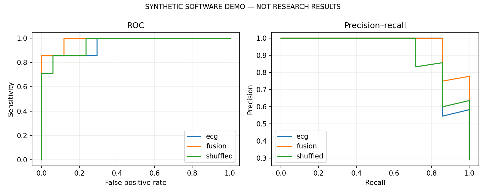
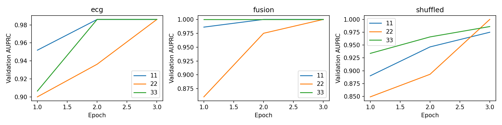
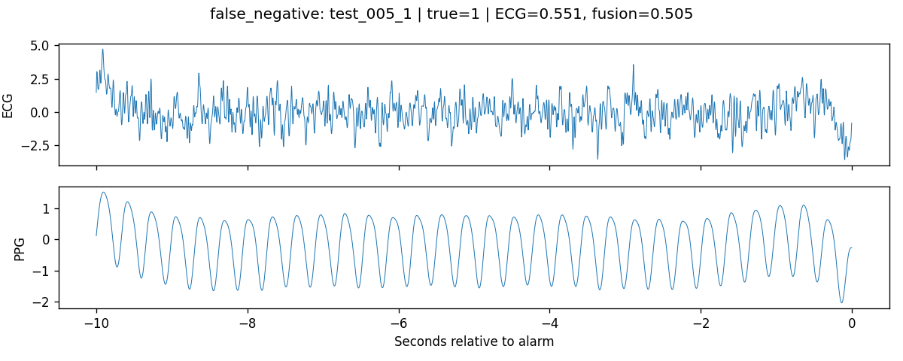
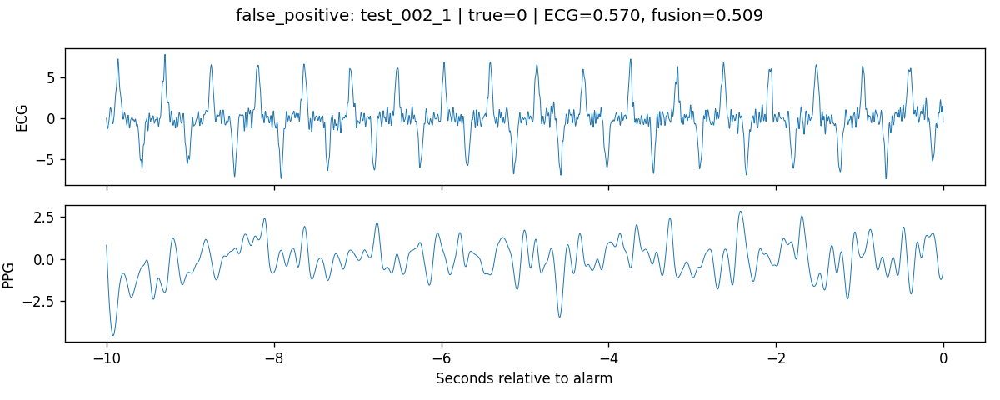
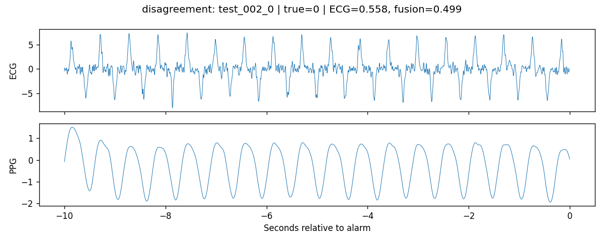
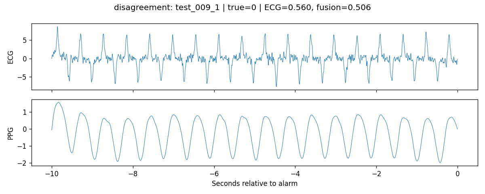

# Reducing false VT alarms

SYNTHETIC SOFTWARE DEMO — NOT RESEARCH RESULTS

## Cohort

| split | events | true | records |
| --- | --- | --- | --- |
| test | 24 | 7 | 12 |
| train | 80 | 30 | 40 |
| validation | 24 | 8 | 12 |

## Frozen operating points

True VT is positive. Thresholds were selected on validation data to maximize specificity subject to sensitivity >= 95%; ties select the lower threshold. Test sensitivity is measured, not guaranteed.

| model | threshold | n | true | sensitivity | specificity | auroc | auprc | fn | fp |
| --- | --- | --- | --- | --- | --- | --- | --- | --- | --- |
| ecg_11 | 0.5534 | 24 | 7 | 0.8571 | 0.7647 | 0.9580 | 0.9405 | 1 | 4 |
| ecg_22 | 0.4684 | 24 | 7 | 1.0000 | 0.7647 | 0.9664 | 0.9367 | 0 | 4 |
| ecg_33 | 0.5168 | 24 | 7 | 0.8571 | 0.7059 | 0.9328 | 0.8929 | 1 | 5 |
| fusion_11 | 0.5070 | 24 | 7 | 0.8571 | 0.9412 | 0.9832 | 0.9683 | 1 | 1 |
| fusion_22 | 0.5588 | 24 | 7 | 1.0000 | 1.0000 | 1.0000 | 1.0000 | 0 | 0 |
| fusion_33 | 0.5095 | 24 | 7 | 1.0000 | 0.9412 | 0.9916 | 0.9821 | 0 | 1 |
| shuffled_11 | 0.4293 | 24 | 7 | 1.0000 | 0.7059 | 0.9580 | 0.9276 | 0 | 5 |
| shuffled_22 | 0.5108 | 24 | 7 | 1.0000 | 0.8235 | 0.9832 | 0.9617 | 0 | 3 |
| shuffled_33 | 0.4236 | 24 | 7 | 1.0000 | 0.7647 | 0.9916 | 0.9821 | 0 | 4 |
| baseline | 0.7520 | 24 | 7 | 0.8571 | 0.8824 | 0.9496 | 0.8917 | 1 | 2 |

## Paired uncertainty

Fusion minus ECG; record-clustered percentile 95% intervals, frozen thresholds, identical draws. These intervals condition on each fitted model, and do not capture retraining uncertainty.

| seed | difference | low | high | valid_replicates | excluded |
| --- | --- | --- | --- | --- | --- |
| 11 | specificity | 0.0237 | 0.3333 | 100 | 0 |
| 11 | sensitivity | 0.0000 | 0.0000 | 100 | 0 |
| 22 | specificity | 0.0556 | 0.4166 | 100 | 0 |
| 22 | sensitivity | 0.0000 | 0.0000 | 100 | 0 |
| 33 | specificity | -0.0573 | 0.4371 | 100 | 0 |
| 33 | sensitivity | 0.0000 | 0.4150 | 100 | 0 |

## Interpretation

Compare sensitivity and missed true-event counts together with false-alarm rejection. A specificity gain with lower sensitivity may be a tradeoff. Inspect bootstrap intervals and quality subgroup counts before claiming a benefit. The shuffled control breaks target-event pairing and target-event PPG information together; it does not isolate timing alone.

Quality cutoffs are training-set medians of waveform proxy scores. They are not clinical quality annotations. Small groups have unstable estimates; no post-test pooling or rule changes are applied. Per-modality and joint ECG/PPG group metrics and intervals are in bootstrap_SEED.json.

## Figures

## Error examples

## Limits

This is an offline research pipeline, not a clinical alarm filter. A 95% validation sensitivity target is not a safety standard. The peak-derived features and waveform quality scores are approximate research proxies. No ABP or external-validation result is included. Synthetic outputs, when marked above, only verify software execution.

## References

- VTaC v1.1: https://physionet.org/content/vtac/1.1/
- Lehman et al., VTaC, NeurIPS 2023: https://github.com/ML-Health/VTaC
