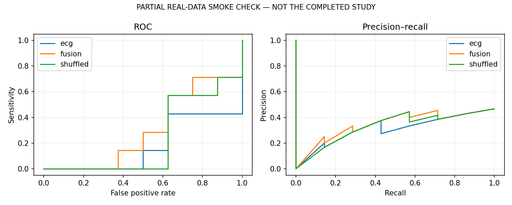
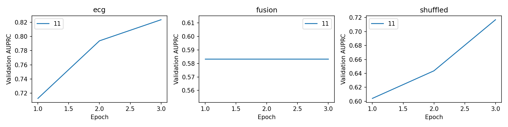
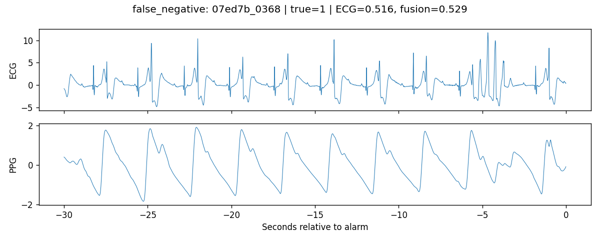
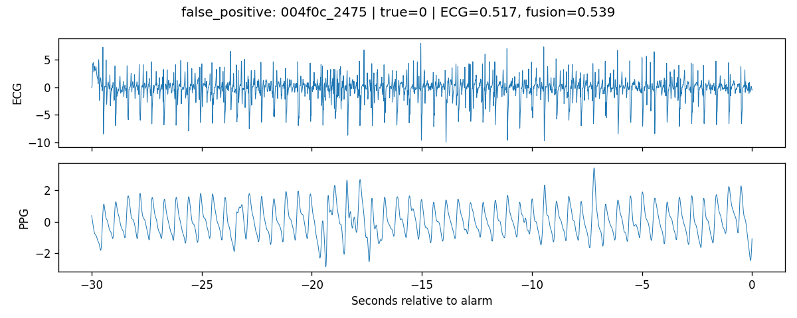
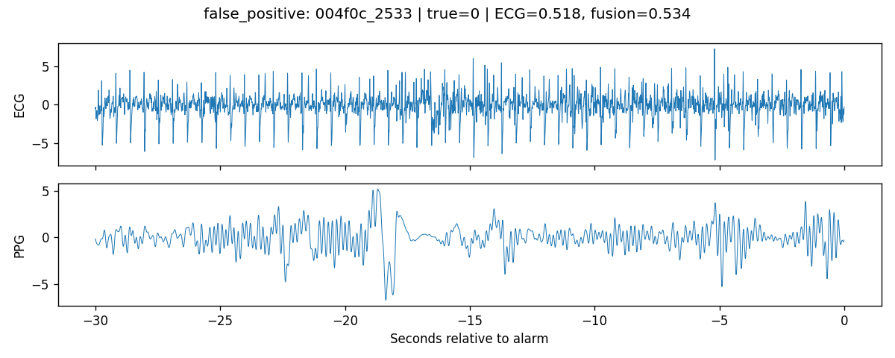
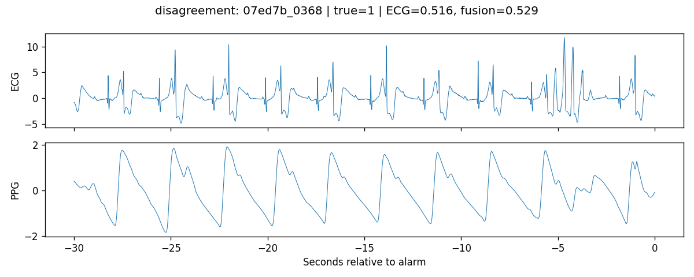

# Reducing false VT alarms

PARTIAL REAL-DATA SMOKE CHECK — NOT THE COMPLETED STUDY

## Cohort

| split | events | true | records |
| --- | --- | --- | --- |
| test | 15 | 7 | 8 |
| train | 14 | 7 | 9 |
| validation | 15 | 8 | 7 |

## Frozen operating points

True VT is positive. Thresholds were selected on validation data to maximize specificity subject to sensitivity >= 95%; ties select the lower threshold. Test sensitivity is measured, not guaranteed.

| model | threshold | n | true | sensitivity | specificity | auroc | auprc | fn | fp |
| --- | --- | --- | --- | --- | --- | --- | --- | --- | --- |
| ecg_11 | 0.5058 | 15 | 7 | 1.0000 | 0.0000 | 0.1786 | 0.3534 | 0 | 8 |
| fusion_11 | 0.5293 | 15 | 7 | 0.8571 | 0.0000 | 0.3036 | 0.3932 | 1 | 8 |
| shuffled_11 | 0.5325 | 15 | 7 | 1.0000 | 0.0000 | 0.2321 | 0.3691 | 0 | 8 |
| baseline | 0.3746 | 15 | 7 | 0.5714 | 0.2500 | 0.3214 | 0.4853 | 3 | 6 |

## Paired uncertainty

Fusion minus ECG; record-clustered percentile 95% intervals, frozen thresholds, identical draws. These intervals condition on each fitted model, and do not capture retraining uncertainty.

| seed | difference | low | high | valid_replicates | excluded |
| --- | --- | --- | --- | --- | --- |
| 11 | specificity | 0.0000 | 0.0000 | 99 | 1 |
| 11 | sensitivity | -0.6350 | 0.0000 | 100 | 0 |

## Interpretation

Compare sensitivity and missed true-event counts together with false-alarm rejection. A specificity gain with lower sensitivity may be a tradeoff. Inspect bootstrap intervals and quality subgroup counts before claiming a benefit. The shuffled control breaks target-event pairing and target-event PPG information together; it does not isolate timing alone.

Quality cutoffs are training-set medians of waveform proxy scores. They are not clinical quality annotations. Small groups have unstable estimates; no post-test pooling or rule changes are applied. Per-modality and joint ECG/PPG group metrics and intervals are in bootstrap_SEED.json.

## Figures

## Error examples

## Limits

This is an offline research pipeline, not a clinical alarm filter. A 95% validation sensitivity target is not a safety standard. The peak-derived features and waveform quality scores are approximate research proxies. No ABP or external-validation result is included. Synthetic outputs, when marked above, only verify software execution.

## References

- VTaC v1.1: https://physionet.org/content/vtac/1.1/
- Lehman et al., VTaC, NeurIPS 2023: https://github.com/ML-Health/VTaC
